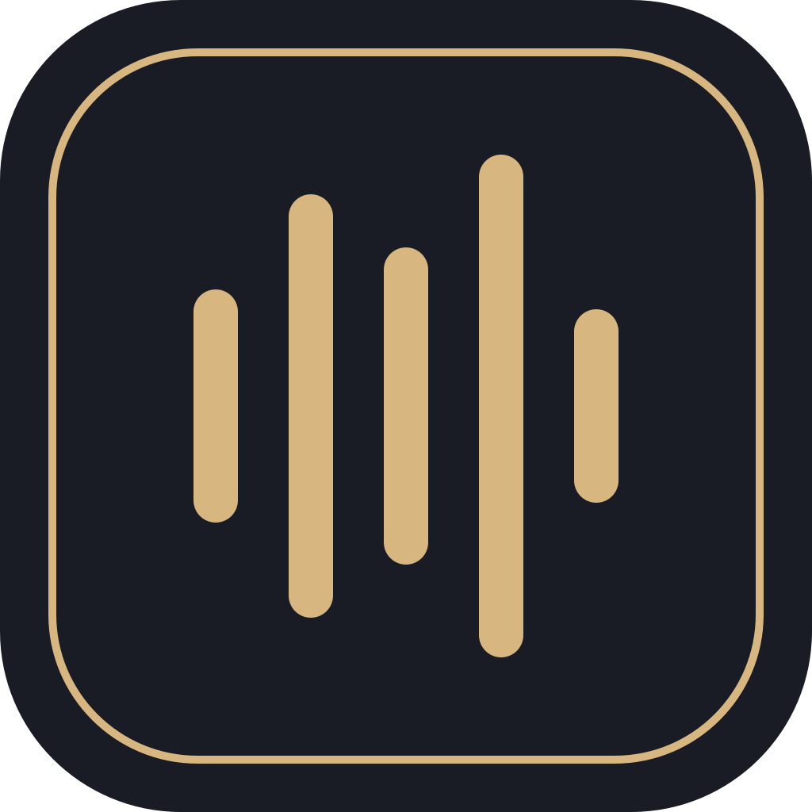
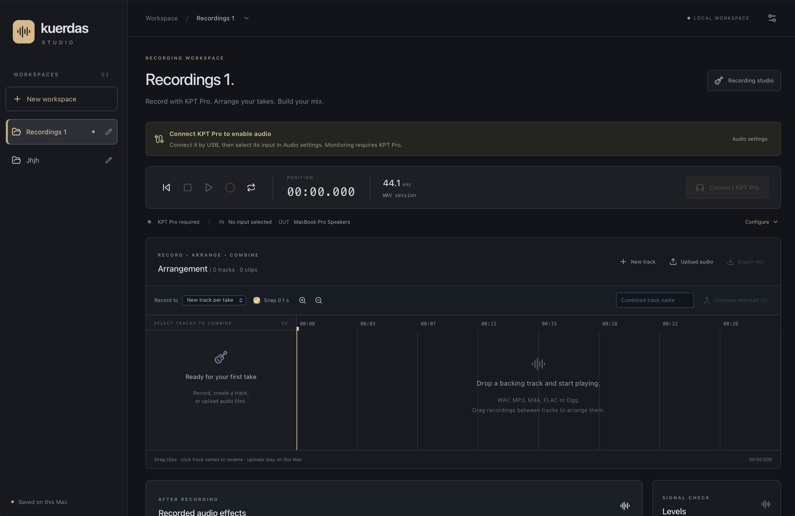
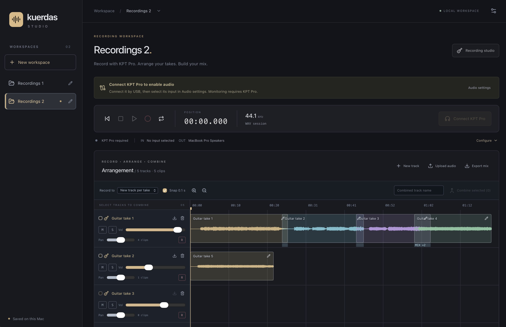

  

<h1 align="center">Kuerdas Studio</h1>

A guitar recording studio for macOS, built around KPT Pro.

  
  
  

## Introduction

Kuerdas helps electric guitarists record takes over backing tracks, arrange and mix their recordings, and export WAV files. Sessions are organized in named workspaces on your Mac. [KPT Pro](https://tankpedal.com/products/drop-shipping-yuimer-tank-upgraded-kpt-pro-white-multi-effect-pedal-ann-new-algorithm-electric-guitar-bass-2-in-1-effector?_pos=1&_sid=872ecc6d8&_ss=r) supplies the live guitar tone; drive and EQ can be applied to copies of recorded audio.

Recording requires a Mac running macOS, KPT Pro connected by USB, and an electric guitar connected to KPT Pro. The observed device appears as **Sinco-Audio** and uses **44.1 kHz**. See the [roadmap](docs/roadmap.md) for future plans.

## Get Started

Create a named workspace, connect KPT Pro, then record over an uploaded backing track. Follow the [recording quick start](docs/quick-start.md) for setup, recording, editing and export instructions. For local development, see [Run locally](docs/run-local.md).

## What you can do

- **Organize recordings:** create, rename and reopen workspaces with separate tracks and audio.
- **Record your guitar:** capture KPT Pro over USB into a new track or an existing lane.
- **Play with backing tracks:** upload WAV, MP3, M4A, FLAC or Ogg files and use playback, loop and overdubbing.
- **Arrange your takes:** drag clips in time or between tracks, rename, split and combine them. Highlights and translucent overlaps help you inspect the arrangement.
- **Build your mix:** adjust track volume, pan, mute and solo, then export individual tracks or a stereo WAV mix.
- **Process recorded audio:** add drive/EQ to a new copy while keeping the original take.

## Screenshots

**Recording workspace**

**Multitrack arrangement**

## Project status

Kuerdas is an early recording preview. Workspaces save locally, imports use managed copies, and editing keeps source recordings intact. Back up the complete workspace folder to preserve an editable session; a mix export is only the rendered audio.

Current limits include 16 tracks, 128 clips, approximately 512 MB of decoded audio, a one-hour timeline and ten-minute takes/imports/combined spans. Latency compensation, undo/redo, automatic crash-take recovery, portable project packaging and release signing remain future work. Sustained hardware and latency testing is still required. See [recording details](docs/recording.md).

## Documentation

| Guide                                              | Purpose                                                            |
| -------------------------------------------------- | ------------------------------------------------------------------ |
| [Recording quick start](docs/quick-start.md)       | Workspaces, recording, backing tracks, editing, mixing and backups |
| [Run locally](docs/run-local.md)                   | Prerequisites, desktop launch and browser preview                  |
| [Development](docs/development.md)                 | Stack, repository structure, checks and packaging                  |
| [Architecture](docs/architecture.md)               | Engine boundaries, threading and persistence                       |
| [Recording details](docs/recording.md)             | Storage, media formats, processing and limitations                 |
| [Testing](docs/testing.md)                         | Automated checks and manual workflows                              |
| [Hardware validation](docs/hardware-validation.md) | KPT Pro compatibility and reliability checks                       |
| [Roadmap](docs/roadmap.md)                         | Longer-term development goals and milestones                       |
| [Session notes](docs/session-notes.md)             | Implementation decisions, evidence and open work                   |

## Contributing

Contributions are welcome. See [CONTRIBUTING.md](CONTRIBUTING.md) for scope, engineering guidelines and checks.

## License

Kuerdas Studio is available under the [MIT License](LICENSE).
