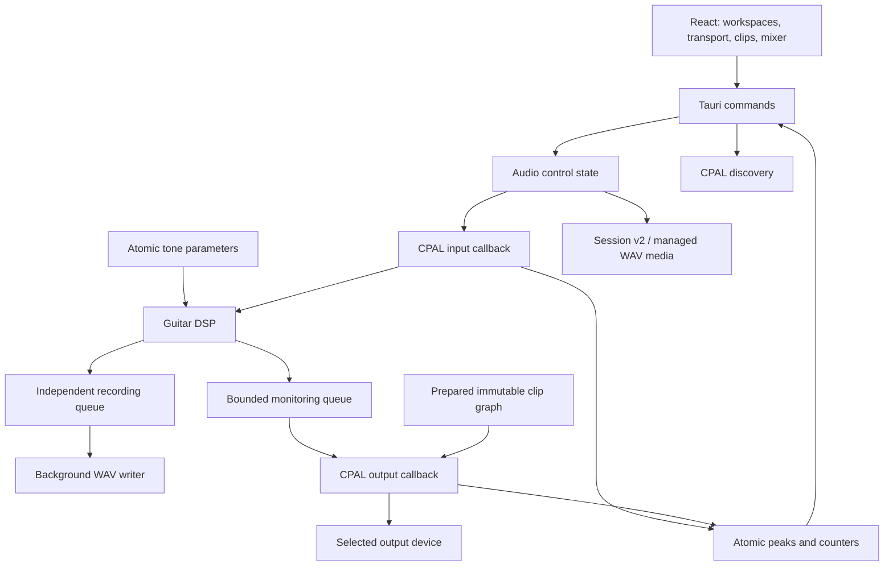

# Architecture

Status: initial implementation, v0.1 development.

## Boundaries

React owns interaction state and preferences through Zustand. It does not own the audio clock. CPAL owns hardware streams; Rust callbacks own their DSP state. The UI polls at approximately 10 Hz, with one outstanding status request per poller. Polling is control-plane work and cannot stall an audio callback.

## Native crates

- **kuerdas-devices:** expose CPAL identifiers and supported configurations, resolve selections again before opening a stream. Names are labels, not identifiers. Disappearing devices produce an error rather than selecting another device silently.
- **kuerdas-audio:** validate the requested configuration; create and start both streams; own stream lifetime; collect diagnostics. A bounded `rtrb` queue transfers one selected mono input channel to the output callback, which duplicates the processed sample to output channels.
- **kuerdas-dsp:** finite-input sanitization, gate envelope, smoothed gain controls, soft clipping and bounded output. All state lives in the callback. Smoothing coefficients are prepared off-thread for the selected 44.1/48 kHz rate.
- **kuerdas-project:** serialization contract for sessions/tracks/clips. Positions and lengths are integer sample frames. Persistence, validation and migrations remain M6 work; this model is not yet exposed as a project-file API.

## Thread rules

| Work                                        | Owner                                 | Real-time constraints                                              |
| ------------------------------------------- | ------------------------------------- | ------------------------------------------------------------------ |
| Discovery, stream configuration, start/stop | Tauri command/control thread          | May allocate and wait; never called by callbacks                   |
| Input channel extraction                    | Input callback                        | No allocation, locks, logging or IPC                               |
| Queue read, DSP, channel duplication        | Output callback                       | Bounded work per frame; queue-empty returns silence                |
| Parameter writes                            | Command handler                       | Finite and bounded before atomic stores                            |
| Parameter reads                             | Output callback                       | Relaxed atomic loads; individual controls may update independently |
| Peak/counter reporting                      | Atomic callback writes, command reads | Meter peaks accumulated using atomic max, consumed on status read  |
| Recording writes                            | Dedicated worker                      | Callback pushes to bounded sample queue; worker writes WAV         |
| Future SQLite/preset operations             | Storage worker/control plane          | Never callback work                                                |

The `Mutex<Engine>` only serializes control commands. The callbacks capture `Arc` handles during setup; they neither clone/drop them per sample nor acquire this mutex. Stream destruction occurs on the control side. A native control worker checks the selected KPT Pro connection every second, independently of React, and stops on missing/replaced input. Error callbacks set an atomic failure flag; output becomes silent and the next status poll drops streams. Explicit restart is required after a fault. Sleep/wake still needs hardware validation and lifecycle handling before beta.

## Storage plan

- Current: versioned browser/WebView local storage for device selections and input trim (former tone preferences archived). No audio is stored. There is no resume-monitoring flag.
- M4: native SQLite for presets, device preferences and metadata; versioned JSON preset exchange; migrations and validation.
- M5–M6: a portable project directory with `session.json`, relative `audio/*.wav`, managed `irs/`, recovery journal and autosave snapshots. Commit metadata with temp-write/rename. Media must remain immutable when referenced by undo history.
- WAV recording/export via `hound` on workers. Import must validate files and make sample-rate conversion explicit.

## Known constraints

The first engine intentionally supports float32 at 44.1 or 48 kHz. Buffer values are requests, not measured device latency. Separate input/output clocks can drift; underrun/overrun counters expose the symptom but adaptive resampling is not implemented. Prefer a single duplex interface for the first hardware milestone. Software DSP is gate/overdrive, two-band tone shaping and delay; proprietary amp/cabinet models are not recreated. No vendor-specific KPT Pro control or dry-signal guarantee is implied.

## Future graph changes

Pedal reordering and IR changes will build a prepared graph off-thread and swap at a block boundary with deferred destruction on the control worker. Never free an old graph or allocate convolution buffers inside a callback. The timeline will render reduced waveform peaks generated by a worker, not process original samples in React. Transport position will come from engine sample frames rather than a JavaScript timer.

## KPT Pro requirement

Current monitoring requires the selected input itself to be KPT Pro. Rust validates the native description before opening streams; hiding other inputs in React is not the enforcement boundary. Device discovery exposes `isKptPro` for presentation only. Matching uses tokenized advertised model names (`KPT Pro` / `KPTPRO`) or the observed `Sinco-Audio` alias together with a `coreaudio:AppleUSBAudioEngine:Jieli Technology:USB Composite Device:<serial>:<endpoint>` UID. Serial values are not hardcoded. The alias/driver combination does not prove a physical model; vendor/product enforcement and other revisions remain hardware work. Generic USB Audio inputs are intentionally blocked. This is a product compatibility gate, not cryptographic hardware authentication. Output devices remain selectable for headphone routing.

## Recording preview extension

`kuerdas-audio/media.rs` owns bounded WAV decode/resampling, cached immutable audio tracks, waveform summaries and the current-session manifest. `recording.rs` owns the off-thread hound writer. The input callback owns guitar DSP and sends contiguous processed samples to the disk-writer queue, independently of the monitoring queue. The output callback renders sample-positioned tracks and the monitored guitar mix. Recording position uses captured input frames; playback position uses output frames. Monitoring underruns/overruns remain diagnostics rather than device-failure flags. Graph/data allocations occur while streams are stopped; atomic track controls ramp across callback blocks. Stop/quit/disconnect finalize the writer on the control side. Workspace session metadata is written atomically and restored when explicitly opened. Explicit per-track/mix export uses native dialogs on workers. See recording.md for limits and unimplemented recovery/latency compensation.

## Multi-clip session extension

Runtime session schema v2 stores a vector of clip metadata per track. Each clip has an immutable managed WAV source, sample-based start, source offset and length. `AudioTrack::stereo_at` sums active clips without allocation. File decoding, resampling, peak generation, splitting and bounce rendering remain on control workers while playback/recording are stopped. Structural changes use detached track/control snapshots and rollback in memory if the atomic metadata commit fails. Legacy v1 takes become single-clip tracks; the original JSON is backed up before conversion is persisted.

Symphonia 0.5.5 handles user-selected MP3, M4A/AAC/ALAC, FLAC and Ogg; managed storage and export remain float WAV. Multi-file dialog/native drops use the same bounded importer. Source media are never deleted by rename, move, split or combine. Combining renders a new stereo source and mutes the originals; recording can target an existing lane.

## Recording-focused workspace boundary

`kuerdas-audio/workspaces.rs` manages validated named folders and copy-only recovery of the previous single session. `WorkspaceCatalog` is control-side state; workspace open/close requires stopped streams and loads/replaces the engine transactionally. The UI starts at the named workspace chooser. Each workspace owns its cached tracks, managed media and manifest. No automatic resume flag is stored.

Live input forces software bypass. `processing.rs` renders optional drive/EQ to a new immutable WAV/track while stopped, preserving and muting the source. No tone-library or roadmap view remains in React; `docs/roadmap.md` retains the long-term plan. The previous tone preferences are archived by the Zustand migration so removing the feature does not silently erase saved user data.
